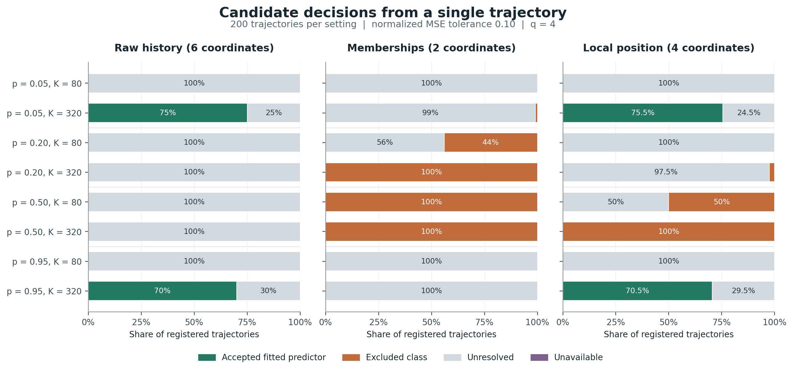
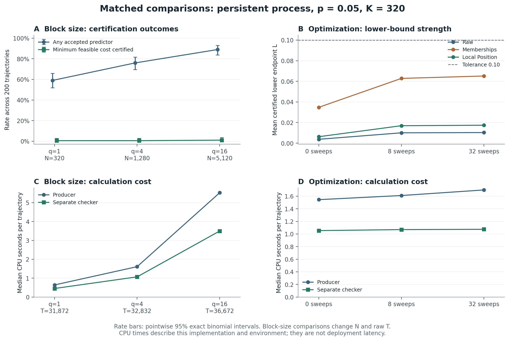

# Prediction certificates from one dependent trajectory

This experiment evaluates finite-sample predictive-risk certificates and
representation selection using a single scalar time series. The procedure
compares a finite family of rational feature maps, certifies an upper risk bound
for each fitted predictor, and obtains a lower risk bound for the full declared
decoder class. When the bounds are informative enough, it also certifies the
smallest feasible coordinate cost within that family.

**Each certification uses one trajectory.** Repeated trajectories provide a
controlled evaluation of the procedure under specified process laws. They are
not additional data required by an individual certification.

The temporal guarantee requires supplied support, stationarity, and dependence
assumptions. Numerical verification checks the computations; it does not infer
these assumptions from an arbitrary finite record. The target is mean squared
prediction risk under the stationary history–target law, rather than the
conditional error of the next observation after a particular realized history.

## Risk and representation selection

For candidate $m$, let $\Gamma_m$ be its encoder, $\mathcal G_m$ its full class
of $[0,1]$-valued Euclidean $\kappa_m$-Lipschitz decoders, and
$\widehat g_m\in\mathcal G_m$ a predictor fitted before calibration. Write
$R_m(g)$ for the stationary mean squared prediction error of decoder
$g\in\mathcal G_m$ through $\Gamma_m$, and
$R_m^*=\inf_{g\in\mathcal G_m}R_m(g)$. The reported endpoints $L_m,U_m$ obey

$$
\Pr\{\text{for every }m:\ L_m\leq R_m^*\leq R_m(\widehat g_m)\leq U_m\}
\geq 1-\delta_{\rm stat}-K\overline\beta(r).
$$

Here $K$ is the number of retained calibration blocks, $r$ their separation lag,
$\overline\beta(r)$ the supplied dependence bound, and $\delta_{\rm stat}$ the
statistical failure allowance. The event is simultaneous over the frozen
candidate family and unconditional over development and calibration.

At required risk $\tau$, the rule accepts a candidate when $U_m\leq\tau$,
excludes its entire decoder class when $L_m>\tau$, and otherwise reports an
unresolved decision. An upper bound concerns the chosen fitted predictor; a
lower bound concerns all decoders in the declared class. Consequently, a poor
fitted predictor does not by itself establish that its representation is
inadequate.

The experiment uses three candidates: six raw history coordinates, two soft
membership coordinates, and four membership-plus-local-position coordinates.
Cost is this declared coordinate count. A minimum-cost certificate concerns
these three packages; it does not establish intrinsic state dimension or
optimality over unexamined encoders. Full formulas, assumptions, and a symbol
table appear in [METHODS.md](METHODS.md).

## Experimental design

The observed process is a stationary symmetric binary Markov chain, initialized
with a fair bit and switching at each transition with probability $p$. Its
dependence coefficient in the stated total-variation convention is
$\beta(r)=\tfrac12|1-2p|^r$. The study contains 200 repetitions in each of twelve
settings:

- Eight primary settings cross $p\in\{0.05,0.20,0.50,0.95\}$ with
  $K\in\{80,320\}$ and use four forecasting windows per block.
- Two matched settings change the block size to one or sixteen windows at
  $p=0.05,K=320$.
- Two matched settings change lower-bound multiplier optimization to zero or
  32 sweeps, compared with the default eight, at $p=0.05,K=320$.

The history length is $h=6$, the development prefix contains 512 observations,
the Lipschitz budget is two, and the risk tolerance is $\tau=0.1$. The gap is
the smallest positive integer satisfying $K\beta(r)\leq0.01$, and the
statistical failure allowance is $0.04$. With block size $q$, the calibration
uses $N=Kq$ windows and requires
$T=512+K(h+q+r-1)$ observations. Thus the block-size comparison changes both
$N$ and $T$ while holding $K$ fixed.

The protocol and seed rules were fixed locally before the scientific
simulation runs. This is a recorded local protocol, not an external
preregistration. Every registered outcome is retained. Matched settings share
trajectory prefixes, so their 2,400 outcomes must not be pooled as independent
trials for a single binomial interval.

## Results

All 2,400 registered runs completed. All 2,400 joint risk events, comprising
7,200 candidate risk sandwiches, were verified as covered by exact population
calculations or certified oracle enclosures. There were no definite violations,
unresolved oracle comparisons, or unavailable executions. The verified outward
rational Monte Carlo failure upper bound in each setting is
$113377/4194304\approx0.02703118$. The twelve upper bounds have simultaneous
95% Monte Carlo confidence under the independent-replicate simulation
interpretation. These observations concern the tested process laws; the
finite-sample theorem supplies the analytical guarantee under its premises.
See [the complete summary](results/summary.json) and
[the independent summary audit](results/independent_summary_audit.json).

| Setting | Any predictor accepted | Compressed predictor accepted | Minimum feasible cost certified |
| --- | ---: | ---: | ---: |
| $p=0.05,K=320,q=4$ | 152/200 | 151/200 | 1/200 |
| $p=0.95,K=320,q=4$ | 142/200 | 141/200 | 0/200 |
| $p=0.05,K=320,q=1$ | 118/200 | 118/200 | 1/200 |
| $p=0.05,K=320,q=16$ | 178/200 | 178/200 | 2/200 |

No $K=80$ run accepted a predictor. At $p=0.20$ and $p=0.50$, all candidate
classes are truly infeasible at tolerance $0.1$, but no entire-family exclusion
was certified. The raw class was never excluded.



### Sources of unresolved decisions

The registered sweep and block-size comparisons assess numerical and
statistical informativeness. Two **post-hoc explanatory analyses** of retained
evidence distinguish three practical limitations:

1. **Sparse empirical constraints.** In one saved independent-bit repetition,
   the raw class has full empirical optimum $0.24016370666$, whereas the sparse
   constraint graph has optimum $0.01959635417$. The returned empirical lower
   value is $0.01959634970$. Missing equality links therefore dominate the gap
   in this example; additional optimization of the same graph cannot recover
   the full empirical optimum. This calculation concerns the specified saved
   repetition, not all repetitions.
2. **Statistical slack.** At $p=0.05,K=320$, the membership candidate's mean
   empirical lower input is $0.109827$, but its mean population lower endpoint
   is $0.062826$. Only two of 187 truly infeasible membership classes are
   excluded. Certifying that a cheaper class fails remains difficult even when
   a four-coordinate fitted predictor is accepted.
3. **Chosen-witness error.** In thirteen developments at $p=0.05,K=320$, the
   membership class can meet the tolerance, but its fitted predictor exceeds
   the tolerance in all thirteen. Their mean class optimum is $0.095473$ and
   mean fitted risk is $0.110080$. Sharper confidence intervals alone cannot
   accept those fitted predictors. This observation does not isolate decoder
   expressiveness from fitting and regularization.

The exact graph calculation is retained in
[posthoc_graph_diagnostic.json](results/posthoc_graph_diagnostic.json); the
descriptive risk and witness calculations are in
[bottleneck_diagnostics.json](results/bottleneck_diagnostics.json).



## Reproduce the evidence

Python's standard library suffices for all computational checks and the full
experiment. Figure regeneration additionally requires the package listed in
[requirements-figures.txt](requirements-figures.txt). The recorded scientific
environment used Python 3.12.14.

From this directory, choose a new absolute output path:

```sh
python3 reproduce.py --mode check --output /tmp/single_trajectory_check
```

This verifies source and evidence identities, copies the retained results to
the new output, runs all 97 original tests, reconstructs the twelve saved full
certificates, recomputes the aggregate summary, and reproduces both post-hoc
diagnostics. All four regenerated evidence files must match their retained
bytes. The supplied results remain unchanged. Add `--figures` to regenerate
the scientific figures in the new output.

To regenerate all 2,400 registered outcomes:

```sh
python3 reproduce.py --mode run --output /tmp/single_trajectory_run --workers 6
```

The exact source archive is extracted into a temporary directory after hash
verification. The wrapper writes results, logs, provenance copies, and a
`reproduction.json` receipt into the requested output. See
[REPRODUCIBILITY.md](REPRODUCIBILITY.md) for environment setup, resumption,
archive inspection, output interpretation, and validation scope.

## Contents and scope

| Item | Scientific purpose |
| --- | --- |
| [METHODS.md](METHODS.md) | Definitions, temporal guarantee, numerical certificates, population oracle, and interpretation |
| [REPRODUCIBILITY.md](REPRODUCIBILITY.md) | Executable reproduction instructions and provenance |
| [reproduce.py](reproduce.py) | Verified entry point for retained-evidence checks and experiment regeneration |
| [source_snapshot.zip](source_snapshot.zip) | Exact implementation, test suite, protocol, and computational validation records |
| [SOURCE_MANIFEST.json](SOURCE_MANIFEST.json) | SHA256 identities of archive members, retained evidence, and figures |
| [results/runs.jsonl.gz](results/runs.jsonl.gz) | Losslessly compressed records for every registered repetition |
| [results/summary.json](results/summary.json) | All setting-wise rates, risk summaries, uncertainty bounds, and matched comparisons |
| [results/certificates/](results/certificates/) | Full saved numerical certificates and population-risk proofs |
| [figures/](figures/) | Scientific figures in PNG and vector PDF formats |

The encoder uses exact rational affine-score memberships and signed local
coordinates. This study does not validate a Gaussian KAHM feature engine,
establish full-history or latent-state recovery, demonstrate autonomous state
evolution, or establish general forecasting superiority. It evaluates
conditional-on-premises predictive certification and finite-family coordinate
selection, including when the procedure remains uninformative.
