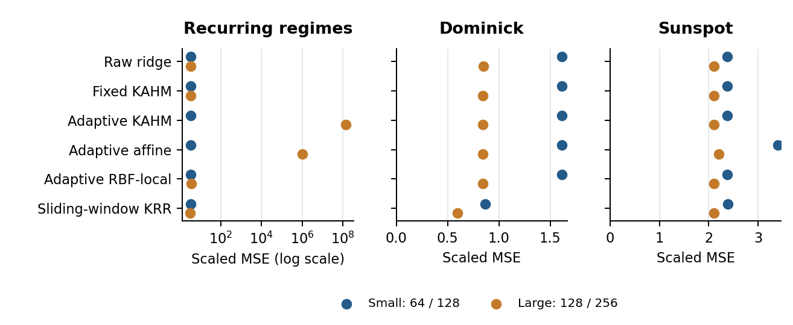
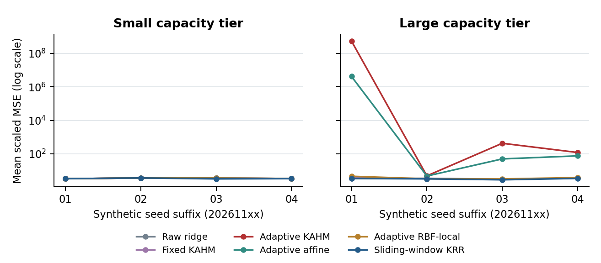

# Online KAHM adaptation: experimental findings

The study evaluates online adaptation under fixed reference and replay-storage quotas. The natural inputs were previously inspected, so their results provide development evidence.

**Adaptive KAHM fails the prespecified accuracy requirements at both capacity tiers.** A numerically stable correction-head solver removes implementation exceptions, but severe extrapolation and unfavorable comparisons remain.

| Capacity tier | Recurring accuracy criterion | Natural accuracy criterion | 99th-percentile service criterion | Combined criterion |
| --- | --- | --- | --- | --- |
| 64 ref cap / 128 replay | Fail | Fail | Pass: 9.89 ms | Not satisfied |
| 128 ref cap / 256 replay | Fail | Fail | Pass: 11.75 ms | Not satisfied |

The completed amended study contains **144 runs and 387,900 scored forecasts**. All runs are technically valid: no unexpected model exceptions, no framework fallback forecasts and no observed capacity violations. An independent-code evidence audit passed 6,713,837 checks. The state quotas bound storage; they do not bound feature or forecast magnitude.

The central obstacle is predictive value. On the recurring generator, large-tier adaptive KAHM has mean scaled MSE **1.376e+08**, versus 3.3623 for raw ridge and 3.2079 for kernel ridge. The real-series results provide no consistent KAHM advantage over all controls.

The initial complete execution required a numerical amendment, and both executions are retained. Because the amendment followed inspection of the initial outcomes and used the same inputs, the second execution is part of the same development study. The statistical and verification records are `analysis/decision.json`, `analysis/collection_metrics.csv`, and `analysis/audit.json`.

## 1. Question, design and controls

The development question was whether a bounded adaptive KAHM representation improves forecasting performance beyond the same online update policy with simpler geometry, and beyond a practical kernel comparator. The protocol specified accuracy and resource criteria for evaluating this hypothesis.

| Development inputs | Streams | Length each | History / horizons |
| --- | --- | --- | --- |
| Stationary nonlinear AR | 4 seeds | 2,048 | 12 / 1, 4, 12 |
| Recurring A/B nonlinear AR | 4 paired seeds | 2,048 | 12 / 1, 4, 12 |
| Dominick weekly SKU profit | 3 preserved series | 393 | 52 / 1, 2, 4 |
| Sunspot daily | 1 preserved series | 4,096 | 28 / 1, 3, 7 |

The stationary and recurring synthetic streams share innovations within each of four seeds. The recurring schedule alternates two nonlinear regimes every 256 observations; the stationary schedule stays in regime A. Both regimes occur in the initial synthetic fitting prefix. Regime labels are retained for analysis and never supplied to a forecaster. The exact equation, seeds and burn-in are in PROTOCOL.md.

### Six methods and two capacity tiers

Raw ridge is the common sliding-window baseline. Fixed KAHM retains its initial geometry while updating its heads. Adaptive KAHM updates geometry and heads. Adaptive affine and adaptive RBF-local use the same reference selection and refresh policy with different geometric features. Sliding-window Gaussian kernel ridge uses recursive add/delete inverse updates and a free intercept; it is not a reproduction of published KRLS-T.

The small tier permits 64 shared geometric references and 128 supervised replay rows per horizon; the large tier permits 128 references and 256 replay rows. A replay row is a history–target pair whose target has already been observed and is retained for updating the predictor. There are four local models of rank at most two. Every 16 observations, an adaptive arm can refresh one local model, retaining half its initial references as anchors and replacing at most four recent references. It rebuilds the affected geometry and all residual heads coherently. Kernel ridge has up to 64 or 128 supports per horizon. These quotas are not equal byte allocations.

### Strict target chronology and limited calibration

The first 35% of each series initializes the model; 35-50% is chronological calibration; the latter half is evaluation. Each observation first scores previously issued forecasts, then releases newly matured labels, updates the model and issues immutable future predictions. At evaluation start, each horizon selects a mixing weight from 0, 0.25, 0.5 and 1 using only calibration forecasts whose targets have already arrived. The weight stays fixed thereafter; the underlying model may continue learning from matured evaluation labels.

No bandwidth, penalty, history, reference-policy or refresh search was performed. Dominick and Sunspot were deliberately chosen from previously inspected manuscript inputs, including contrasting earlier KAHM outcomes. Their reuse supports development decisions, not new-source confirmation.

Evidence: PROTOCOL.md, config.json, DATA_PROVENANCE.md, prepared_inputs/manifest.json and run.py. The original and amended scientific source checkpoints are local, not public preregistration.

## 2. Forecasting results

Primary loss is MSE divided by the mean squared seasonal difference in the initial fitting prefix. Average origins within horizon, horizons within series, then series within collection. The natural mean weights Dominick and Sunspot equally; synthetic conditions remain separate. Smaller is better; bold marks the best value, including numerical ties. This online schedule and scale differ from the earlier manuscript tables, so their numerical scores are not directly comparable.

### Small tier: 64 references and 128 replay rows

| Method | Stationary | Recurring | Dominick | Sunspot | Natural mean |
| --- | --- | --- | --- | --- | --- |
| Raw ridge | 2.2402 | 3.4583 | 1.6144 | 2.3697 | 1.9920 |
| Fixed KAHM | 2.2407 | 3.4583 | 1.6134 | 2.3697 | 1.9915 |
| Adaptive KAHM | 2.2399 | 3.4583 | 1.6135 | 2.3697 | 1.9916 |
| Adaptive affine | 2.2407 | 3.4583 | 1.6137 | 3.4004 | 2.5071 |
| Adaptive RBF-local | 2.2428 | 3.4583 | 1.6160 | 2.3697 | 1.9928 |
| Sliding-window KRR | 2.2491 | 3.3578 | 0.8685 | 2.3897 | 1.6291 |

### Large tier: 128 references and 256 replay rows

| Method | Stationary | Recurring | Dominick | Sunspot | Natural mean |
| --- | --- | --- | --- | --- | --- |
| Raw ridge | 2.0275 | 3.3623 | 0.8471 | 2.1045 | 1.4758 |
| Fixed KAHM | 2.0375 | 3.4031 | 0.8464 | 2.1045 | 1.4754 |
| Adaptive KAHM | 2.0280 | 1.376e+08 | 0.8444 | 2.1045 | 1.4744 |
| Adaptive affine | 2.0364 | 1.061e+06 | 0.8446 | 2.2085 | 1.5266 |
| Adaptive RBF-local | 2.0290 | 3.7036 | 0.8460 | 2.1045 | 1.4752 |
| Sliding-window KRR | 2.0551 | 3.2079 | 0.5954 | 2.1045 | 1.3499 |

On the equal-collection natural mean, adaptive KAHM is 22.26% worse than kernel ridge in the small tier and 9.22% worse in the large tier. Its gains over adaptive RBF-local are only 0.062% and 0.054%, respectively, below the 1% natural-aggregate threshold.

The large-tier Dominick result is 0.325% better than raw ridge and 0.022% better than adaptive affine, but 41.82% worse than kernel ridge. This is insufficient evidence of a useful KAHM-specific advantage.

Calibration activates the KAHM correction on only 2/12 natural-data horizon/series combinations in the small tier and 2/12 in the large tier. On Sunspot, every KAHM horizon selects zero correction at both tiers. Those forecasts reproduce the common baseline to numerical precision and do not demonstrate added value from KAHM.

All per-series and per-horizon outcomes, calibration weights, resources and comparisons are retained in analysis/task_metrics.csv, horizon_metrics.csv, collection_metrics.csv and comparisons.csv. A value below one compares loss with the training-prefix scale; it does not by itself establish superiority over an evaluated seasonal-naive forecast. No window-level significance tests or broad transfer confidence intervals are claimed.

## 3. Extrapolation on recurring-regime streams

In the small tier, KAHM activates 0/12 recurring-condition corrections. A method that selects a zero contribution can recover the baseline but cannot establish the proposed geometric advantage. In the large tier, 9/12 corrections are active, but severe errors occur after regime changes.

### An extreme forecast and its fitted state

For recurring seed 20261101, the largest amended KAHM forecast error occurs at origin 1554, horizon 12. The forecast is **175,555.08** while the observed target is **-0.9815**; the raw baseline component is -0.4923. Evaluation targets for this stream range from -1.780 to 1.286. The burst is a severe forecasting failure relative to the scale of the observed series.

The preserved diagnostic replay state (large KAHM, seed 20261101, origin 1554, horizon 12) explains why a numerical repair alone is insufficient. Its query's largest standardized feature is about 3.20 million, compared with about 392 among the supervised rows retained at that time. A fresh, correctly solved ridge objective still produces a correction of about 175,556. The adaptive affine arm also exhibits severe extrapolation under a fresh solve.

These observations are consistent with extrapolation arising from the changing representation and delayed-label replay: a current query can lie far outside the feature range represented by its matured long-horizon training rows. Isolating the contribution of scaling, label delay and reference changes would require a dedicated intervention or ablation. The KAHM signed-denominator check is safe at the preserved diagnostic state, so that particular guard does not prevent the failure.

These explanations are post-run diagnostics. They did not change the evaluated predictions, normalization, correction multipliers, or decision criteria. The corresponding records are `AMENDMENT_DIAGNOSTICS.py`, `AMENDMENT_DIAGNOSTICS.json`, `AMENDMENT_DIAGNOSTICS.md`, and `analysis/post_run_diagnostics.json`.

## 4. Runtime and bounded state

The table reports the worst observed value across the 12 streams for each method/tier. A row's timing and memory maxima can come from different streams. Here p99 denotes the 99th percentile of per-observation service time. It is computed separately for each stream before taking the maximum across streams.

| Method / tier | Worst p99 ms | Maximum ms | Max sampled owned NumPy KiB | Worker RSS MiB |
| --- | --- | --- | --- | --- |
| Raw ridge / small | 0.55 | 1.77 | 300.3 | 150.5 |
| Raw ridge / large | 1.26 | 4.54 | 465.7 | 150.5 |
| Fixed KAHM / small | 4.98 | 29.01 | 466.3 | 150.5 |
| Fixed KAHM / large | 8.61 | 27.24 | 685.4 | 150.5 |
| Adaptive KAHM / small | 9.89 | 49.10 | 519.0 | 150.5 |
| Adaptive KAHM / large | 11.75 | 23.60 | 824.5 | 150.5 |
| Adaptive affine / small | 9.56 | 24.75 | 509.8 | 150.5 |
| Adaptive affine / large | 7.00 | 13.44 | 791.4 | 150.5 |
| Adaptive RBF-local / small | 5.05 | 12.05 | 509.8 | 150.5 |
| Adaptive RBF-local / large | 4.58 | 8.00 | 791.4 | 150.5 |
| Sliding-window KRR / small | 3.15 | 3.95 | 477.3 | 150.5 |
| Sliding-window KRR / large | 3.42 | 13.49 | 1011.7 | 150.5 |

Adaptive KAHM's worst per-stream p99 is 9.89 ms in the small tier and 11.75 ms in the large tier. Across its 21,662 evaluation observation steps, 4 service intervals exceed 20 ms. The criterion concerns p99 on every stream; it does not require every single step to be below the allowance.

Service time includes history/pair assembly, all matured-horizon updates, geometry refreshes, feature/head rebuilds, kernel inverse audits and prediction. Initialization and calibration costs are recorded separately. Scoring, evidence serialization and state inspection are excluded. Workers run serially in fresh processes with one numerical thread and the same CPU affinity; detailed runtime/library metadata are retained in every summary.

Owned NumPy memory is the largest sampled total of unique model-owned array buffers. It excludes Python object overhead, temporary work arrays and the external evidence queues. Whole-worker peak RSS includes the interpreter, numerical libraries, input arrays and evidence storage. These are complementary measurements, neither a precise peak incremental deployment footprint.

The two capacity tiers are quotas, not equal memory or equal computational work. Kernel supports are separate for each horizon; the geometric bank is shared. Adaptive geometry remains active even when calibration selects a zero correction, so these are costs of the measured eager prototype. A disabled module could cost less. The 20 ms allowance is a monitored feasibility screen on this host, not an enforced scheduling guarantee or an application-derived service-level requirement.

Evidence: analysis/task_metrics.csv and each results/*/summary.json and trace.json. Complete initialization, calibration, mean/median/p95/p99/maximum service, update and prediction timings are retained.

## 5. Numerical amendment and audit

The two executions distinguish numerical implementation failure from the behavior of the fitted forecasting function. The first complete execution is archived with its exact source and evidence. Amendment A1 changes only the correction-head solver, after which the complete roster is repeated.

| Evidence item | Original attempt | Amendment A1 repeat |
| --- | --- | --- |
| Completed method/tier/stream runs | 144 | 144 |
| Scored forecasts | 387,900 | 387,900 |
| Unexpected model exceptions | 4 | 0 |
| Framework fallback forecasts | 8,659 | 0 |
| Observed cap violations | 0 | 0 |
| Independent consistency audit | Passed; 6,704,494 checks | Passed; 6,713,837 checks |
| Prespecified decision | TECHNICAL_BLOCK | Not satisfied |

### Stable solution of the correction-head objective

The original failures were in correction-head normal equations. In a reproduced failing state, accumulated and freshly reconstructed feature cross-products differed by about 2.70 billion. The accumulated ridge matrix had a negative eigenvalue, while the fresh matrix's smallest eigenvalue was approximately one. Large standardized rows entering and leaving a finite window had caused subtractive cancellation.

A1 recomputes current-baseline residuals from the same bounded replay, centers features and targets to eliminate the free intercept, and solves the augmented ridge objective with column equilibration and pivoted QR. The penalty rows receive the same variable transformation. The fitted objective and ridge penalty remain unchanged. The same implementation serves all four geometric arms; raw ridge, scalers, geometry, kernel settings, reference policy, correction-multiplier grid, chronology and decision rules are unchanged.

All 13 numerical and chronology tests passed before the repeat. They include agreement with independent batch objectives, stable eviction of huge transient features, unchanged raw baseline coefficients, coherent geometry rebuilds, matured-target checks and invariance of earlier forecasts to perturbations of later observations.

The saved-evidence audit reconstructs target values, forecast coverage, target timing, calibration selection, losses, aggregates, decision gates, timing summaries, capacity samples, shared baselines and matched adaptive reference updates. Its maximum shared-baseline discrepancy is 5.8e-11. It imports neither the forecasting model nor the original analyzer. This is independent computational consistency checking within the study, not external scientific replication.

All first-attempt records remain in archives/initial_attempt.zip. A1 was made after observing those outcomes; the repeat is not a new independent experiment. Counting two executions as 288 independent experimental units would be incorrect. Evidence: AMENDMENT_A1.md, AMENDMENT_VALIDATION.json, AMENDMENT_TEST_LOG.txt, AMENDMENT_DIAGNOSTICS.* and analysis/audit.json.

## 6. Accuracy criteria and interpretation

Both capacity tiers fail the recurring-regime and natural-data accuracy criteria. Meeting the runtime criterion therefore does not establish the combined accuracy-and-resource requirement.

The recurring condition required at least 3% mean loss reduction relative to each of adaptive affine, adaptive RBF-local, and kernel ridge, with lower loss on at least three of four paired seeds in each comparison. It also required at least 1% improvement over fixed KAHM and raw ridge. The natural-data condition required at least 1% improvement on the equally weighted two-collection aggregate relative to each main comparator, at least 3% improvement relative to all three on the same collection, and no collection with loss more than 5% higher than any main comparator. The resource criterion required service-time p99 at or below 20 ms on every stream, with no unexpected exception or storage-cap violation in any procedure.

These thresholds are fixed development criteria, not a calibrated hypothesis test or a universal definition of practical effectiveness. They were specified before the initial execution and retained after the numerical amendment. The recorded amended decision is `DEFER`, indicating that the accuracy criteria are not satisfied despite technically valid execution.

The results concern one fixed adaptive design, one synthetic generator with four paired seeds, and two previously inspected natural collections. The prototype does not repeatedly optimize the bandwidths and gate temperatures of the separate direct-training study. It therefore does not establish a general impossibility result for KAHM representations. It does show that storage quotas, correct linear algebra, and a low measured service-time percentile are insufficient to guarantee useful forecasting corrections.

## 7. Reproduction and provenance

The [reproduction guide](REPRODUCING.md) provides copyable commands for recomputing the saved analysis and repeating the forecasting procedure. The evidence includes prepared inputs, issued forecasts, traces, selected calibration weights, summaries, analysis tables, independent-code checks, and the original execution archive.

The initial and amended source checkpoints are local records. Their identities are:

| Record | Commit |
| --- | --- |
| Upstream parent | `88e9c568ee983856804a2b2da41f6290f259b8cd` |
| Initial local checkpoint | `3d374de47d694f6ae3267e4b6ac82787755eeca5` |
| Amendment A1 local checkpoint | `6027eb995ca91adeab23711b71a3ae1790c9654e` |

The initial archive hash appears in `archives/initial_attempt_record.json`. The A1 freeze SHA-256 is `140085b63b4af295cb6f631125e6a0c74aec84b7b2708c4fbed3fe21a98b35af`. These identities describe execution provenance, not public preregistration.

### Data attribution

The Dominick data are weekly retailer SKU profit series from the Monash Time Series Forecasting Repository, version 2, DOI [10.5281/zenodo.4654802](https://doi.org/10.5281/zenodo.4654802), originally provided by the University of Chicago Kilts Center. This study uses series T7830, T25851, and T108533.

The Sunspot data are the daily series from the Monash repository, version 4, DOI [10.5281/zenodo.4654773](https://doi.org/10.5281/zenodo.4654773), originally provided by SILSO. The finite 4,096-observation crop of T1 begins at original raw index 69,828; no interpolation is performed.

The pinned archive metadata declare CC BY 4.0. Source hashes, creator metadata, selection, and transformations are recorded in `DATA_PROVENANCE.md` and the source manifest. Code follows the repository MIT license, while `DATA_LICENSE` states the scope of original non-code outputs and third-party exclusions. AI tools assisted implementation, checks, analysis, and report preparation.
