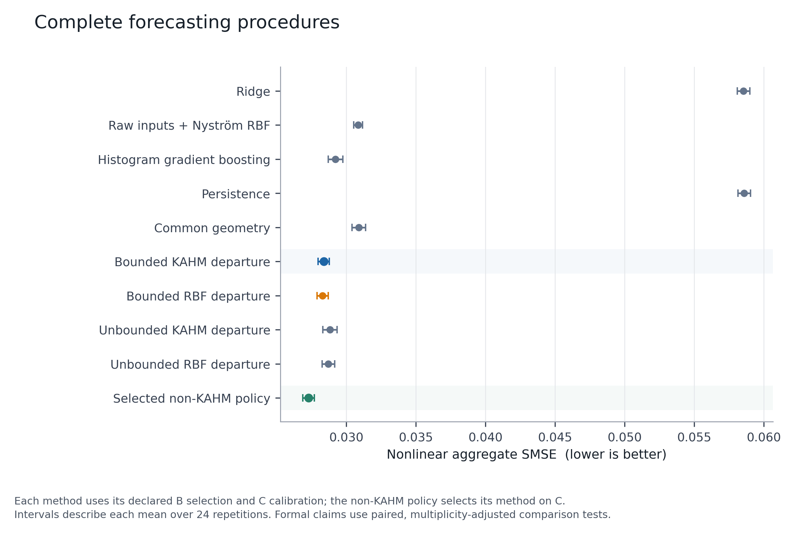
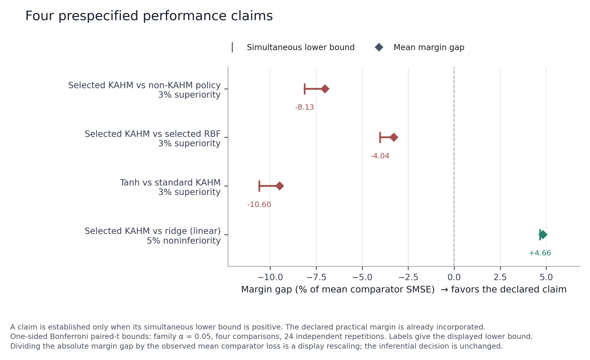
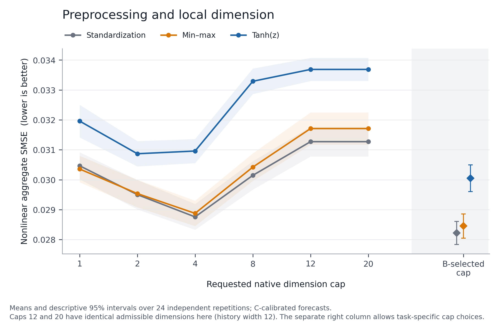
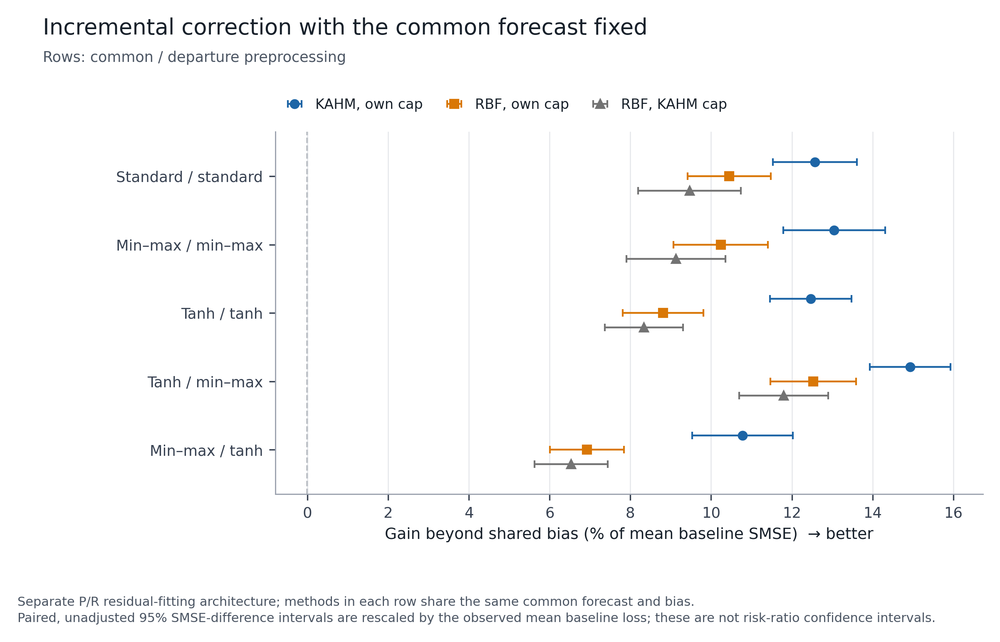

# Preprocessing and validation-selected subspaces in KAHM forecasting

**Controlled simulation study - 1 November 2026**

## Abstract

Training-fitted tanh preprocessing was evaluated after correcting and selecting the local subspace dimension of kernel affine hull features. A prospective source and analysis freeze defined five common/departure preprocessing pairs, six native dimension caps, expanded RBF controls, and four simultaneous primary comparisons. The study comprised 24 independent repetitions and 192 task suites from four numerical observation laws. The tanh diagonal procedure had 6.49% higher aggregate nonlinear standardized mean squared error (SMSE) than the standard diagonal procedure, with an adverse difference in every repetition aggregate. Jointly selected KAHM had 4.02% higher error than the selected non-KAHM policy and 0.28% higher error than independently selected bounded RBF. Only the linear-control noninferiority claim was established.

A separate experiment held the common forecast and shared bias fixed and fitted centered corrections to honest residuals from disjoint episodes. KAHM reduced error beyond shared bias by 10.78-14.93% and improved over independently selected RBF by 2.37-4.14% across its five settings. These secondary comparisons support a focused residual-correction mechanism under the declared allocation, while the primary comparisons do not establish a practical advantage for tanh or for the selected complete KAHM procedure.

## 1. Experimental design

The laws were linear autoregression, nonlinear autoregression, Van der Pol, and Duffing, each at added-noise levels 0 and 0.1. History length was 12 and horizons were 1, 4, and 12. Independent A/B/C/D episode counts were 64/32/32/128, with 512/256/256/1664 retained forecast rows. The 13 origins within an episode were dependent. Inference therefore used 24 independent repetition aggregates, rather than treating 192 tasks or forecast rows as independent observations.

For every horizon, SMSE was test MSE divided by the population variance of retained A targets, with a floor of 1e-12. Horizons were averaged equally, followed by equal averaging over the three nonlinear laws and two noise conditions within each repetition. Linear controls were analyzed separately. Lower SMSE is better. A percentage error change in the tables is positive when the candidate has higher error than its comparator.

All native caps 1, 2, 4, 8, 12, and 20 were fitted. Each local construction began at `min(cap, d, N_local - 1)` and applied the verified native numerical rank rules. No extra normal-direction reservation was imposed. Caps 12 and 20 were identical at this study's ambient dimension 12; both were independently fitted and checked. A cap is a construction limit, not a guarantee that every local model has that rank.

In the primary experiment, geometry histories used training-only standardization, an unclipped min-max map to [-1,1] on training values, or `tanh((x - mean_A) / std_A)`. Exactly constant min-max fitting coordinates mapped to zero. Transformed tanh histories were not restandardized. The finite design also included tanh common features with min-max departures and the reverse combination. Primary hybrid banks shared one requested cap. Existing feature-level standardization and radial bounds were retained after geometry construction.

In the primary architecture, complete heads refitted concatenated common and departure features against the raw-ridge residual. B selected ridge penalties by horizon, then one pair and cap across horizons, independently for each procedure. Raw RBF also received all three history scalers; HGB retained its native raw-input grid. B choices were saved before C was loaded. C selected finite blend multipliers and the non-KAHM family from the already B-selected procedures. The shared raw ridge and target units were unchanged. Full details are in the frozen protocol and analysis protocol.

<!-- pagebreak -->

## 2. Complete forecasting procedures

The primary selected context compares complete tuning and calibration procedures. Common geometry, bounded RBF, and unbounded RBF select their own applicable preprocessing and dimensions; they are not constrained to KAHM's selected bank.

| Procedure | Nonlinear SMSE | Linear SMSE |
| --- | ---: | ---: |
| Ridge | 0.058546 | 0.911654 |
| Raw inputs + Nystrom RBF | 0.030843 | 0.914616 |
| Histogram gradient boosting | 0.029220 | 0.913663 |
| Persistence | 0.058596 | 0.911702 |
| Common geometry | 0.030897 | 0.912435 |
| Bounded KAHM departure | 0.028372 | 0.913255 |
| Bounded RBF departure | 0.028292 | 0.913001 |
| Unbounded KAHM departure | 0.028809 | 0.913436 |
| Unbounded RBF departure | 0.028706 | 0.913234 |
| Selected non-KAHM policy | 0.027275 | 0.914288 |

The selected KAHM procedure improved over selected common geometry by 8.17%, but did not improve over the selected non-KAHM policy. Its difference from independently selected bounded RBF was small: +0.00007960 SMSE, with a descriptive unadjusted paired 95% interval of approximately [-0.000107, 0.000267]. This interval does not establish equivalence. At KAHM's selected complete bank, the KAHM point advantage over RBF was 0.77%, and its descriptive interval also included zero. The complete-procedure evidence therefore does not establish the prespecified 3% KAHM-specific margin.

## 3. Simultaneous primary comparisons

The four one-sided margin gaps used Bonferroni allocation of family alpha 0.05 and a t critical value of 2.397875 with 23 degrees of freedom. A claim was established only when its simultaneous lower margin gap was positive. The nonlinear requirement was at least 3% superiority; the linear requirement allowed at most 5% degradation relative to ridge. The lower-gap column is in SMSE units and already incorporates the required margin.

| Comparison | Required margin | Error change (%) | Simultaneous lower gap | Established |
| --- | --- | ---: | ---: | --- |
| Selected KAHM vs non-KAHM policy | 3% superiority | +4.022 | -0.002217 | No |
| Selected KAHM vs selected RBF | 3% superiority | +0.281 | -0.001142 | No |
| Tanh KAHM vs standard KAHM | 3% superiority | +6.486 | -0.002991 | No |
| Selected KAHM vs ridge, linear | 5% noninferiority | +0.176 | 0.042510 | Yes |

Only one of four claims was established: linear-control noninferiority. The selected KAHM error was 0.176% higher than ridge on that panel, within the declared 5% allowance. Passing this control and the numerical stability screens does not compensate for the failed nonlinear superiority claims. Failure of a superiority test is not a proof of equivalence or a universal claim about other data populations.

<!-- pagebreak -->

## 4. Preprocessing, hybrids, and dimension selection

Each fixed preprocessing row below selected its native cap on B. The joint row additionally selected the preprocessing pair on B. These rows were all specified before test evaluation.

| Common / departure preprocessing | Nonlinear SMSE | Error change versus standard (%) |
| --- | ---: | ---: |
| Standard / standard | 0.028221 | +0.000 |
| Min-max / min-max | 0.028453 | +0.824 |
| Tanh / tanh | 0.030051 | +6.486 |
| Tanh common / min-max departure | 0.028503 | +1.000 |
| Min-max common / tanh departure | 0.029227 | +3.564 |
| Joint preprocessing and cap selection | 0.028372 | +0.535 |

Tanh had 6.486% higher error than standardization and 5.616% higher error than min-max. Both adverse differences occurred in all 24 repetition aggregates. The descriptive unadjusted 95% interval for tanh minus standard was [0.001559, 0.002102] SMSE. With the C blend fixed at one, the tanh penalty relative to standard remained 6.487%. Tanh also had higher aggregate error at every prespecified fixed cap. Calibration therefore did not create the unfavorable result.

The tanh-common/min-max-departure hybrid improved on tanh/tanh by 5.151%, but remained above the standard and min-max diagonal errors. The reverse hybrid was 2.717% worse than min-max/min-max. These full-head comparisons establish that the two blocks' preprocessing choices are consequential under the finite design; they do not hold the fitted common forecast fixed.

Selecting the dimension reduced nonlinear KAHM error by 2.963% relative to fixed native cap 2 and by 7.136% relative to fixed native cap 20, when those fixed-cap contexts also selected preprocessing on B. The nonlinear joint selections used caps 1/2/4/8/12 on 12/22/79/20/11 of 144 tasks. Cap 20 tied exactly with 12 and was not selected. Those frequencies do not justify replacing validation selection with a universal cap of four.

The joint search had slightly higher observed error than the prespecified standard-only cap-selected procedure. The primary arm remains the frozen joint selection rule; the lowest test row was not retrospectively substituted for it. Increasing a validation search menu need not improve the resulting held-out procedure.

## 5. Honest corrections around a fixed common forecast

The secondary architecture partitioned A by whole episode into P and R: the first 32 episode identities fitted each common predictor, and the remaining 32 supplied honest residual targets. All history scalers and banks were fitted on P. The common cap was fixed per row, while departure caps were selected separately. B selected common settings without access to R outcomes. Common selection used P target variance, so R targets could not enter through a normalization denominator. Departure feature statistics and ridge slopes were fitted on R. One B residual-mean bias was frozen per common row. The correction used centered bounded features times ridge slopes and omitted the response-mean intercept. B selected departure penalties and caps; C selected only the incremental multiplier.

Within each common row, KAHM and RBF therefore had the identical common-plus-bias baseline. Different common models generated their own residual targets. The complete main experiment and this smaller-common-fit mechanism experiment have different allocations and must not be pooled into a single ranking.

| Common / departure | Shared-bias baseline | KAHM | Selected RBF | KAHM gain over bias (%) | KAHM gain over RBF (%) |
| --- | ---: | ---: | ---: | ---: | ---: |
| Standard / standard | 0.034008 | 0.029732 | 0.030454 | 12.572 | 2.372 |
| Min-max / min-max | 0.033924 | 0.029497 | 0.030449 | 13.048 | 3.127 |
| Tanh / tanh | 0.035919 | 0.031441 | 0.032755 | 12.466 | 4.009 |
| Tanh / min-max | 0.035919 | 0.030555 | 0.031418 | 14.934 | 2.748 |
| Min-max / tanh | 0.033924 | 0.030267 | 0.031574 | 10.780 | 4.140 |

Across these five cells, KAHM improved over independently cap-selected RBF by 2.372-4.140%, and over RBF at the KAHM-selected departure cap by 3.431-4.543%. All corresponding descriptive paired intervals favored KAHM. These intervals are unadjusted secondary inference; they are not replacements for the primary simultaneous margin tests.

With the tanh common forecast fixed, replacing tanh departure preprocessing with min-max improved KAHM by 2.819%. With the min-max common forecast fixed, introducing tanh departures worsened KAHM by 2.608%. The KAHM two-by-two interaction interval in this fixed-common design included zero. The evidence supports a benefit of min-max departures in both tested common rows, without establishing a distinctive interaction synergy.

The tanh-common/min-max-departure cell achieved the largest percentage gain over its own baseline, 14.934%, but its absolute SMSE was 0.030555. Min-max/min-max had lower absolute error, 0.029497. The larger percentage gain partly reflects the weaker tanh common predictor.

## 6. Heterogeneity and numerical behavior

Tanh's largest penalties relative to standardization appeared for noiseless Van der Pol (+25.89%), noiseless Duffing (+14.20%), and noisy Van der Pol (+9.55%). Nonlinear autoregression changed little; its noisy condition had a 0.039% point improvement. These condition summaries are descriptive and do not define a retrospectively chosen deployment rule.

The strongest-policy deficit was especially visible for noiseless Van der Pol. HGB and the selected policy achieved SMSE 0.003999, compared with selected KAHM at 0.008756. The policy chose HGB in all 24 repetitions of that condition. Conversely, selected KAHM had lower mean error than the policy on noiseless Duffing. The aggregate conclusion coexists with this heterogeneity.

All 192 selected-procedure maximum-error screens passed; the largest selected KAHM-to-ridge maximum-error ratio was 1.376197, below the declared limit of five. No unexpected factor, coordinate, gate, or kernel failure was recorded. Normalized-reconstruction guard row counts and coefficient/correction-bound violations were zero. The documented zero-rank fallback in the native-policy wrapper was retained: 36 primary local-model query records per reconstruction kind, all under tanh, and 13 secondary records per kind. These counts include repeated caps or cached-bank evaluations and are not failed tasks. Their association with tanh does not by itself explain the predictive differences.

## 7. Integrity, resources, and reproducibility

The source/configuration/analysis freeze preceded development-data generation. Every fit and B selection was sealed before test episode generation. Every forecast was sealed before targets were released for scoring. No task, candidate, or scientific outcome was omitted, and no frozen numerical source was changed during production. This was a prospective local source freeze, subsequently preserved on GitHub, rather than a public preregistration.

The independent audit checked all 192 development tasks, 28,800 B scores, 7,680 B context choices, 1,536 C policy choices, and 3,456 A-only geometry banks. It independently reconstructed 48,384 actual local bases and verified all task-to-repetition aggregate arithmetic and the four primary comparisons. Full raw forecast-to-loss reconstruction covered the prespecified eight repetition-zero tasks: 4,016 arrays and 12,048 horizon-loss joins. It did not replay raw losses for every task. All 33 analysis-table checksums passed.

The complete fit stage took 668.6 seconds and prediction took 327.0 seconds with three workers and one numerical thread per worker. These totals include the finite search and diagnostic procedures. They are shared-host study timings, not isolated per-method deployment costs. This experiment consequently does not establish a method-level cost-effectiveness ranking.

The analysis package contains all exported tables, checksums, figure metadata, and the independent audit. Twelve disjoint numerical archives retain development and test arrays, fitted states, validation/calibration forecasts, all 96,384 terminal forecast arrays, local-basis records, diagnostics, and execution receipts. Each archived member is checked against its original SHA-256 digest. Source and reconstruction commands are supplied by the pinned research branch.

## 8. Interpretation and next research question

Under this design, tanh(z) does not improve the cap-selected complete KAHM forecast, and the joint preprocessing/dimension search does not establish a practical advantage over the selected non-KAHM policy. The results favor retaining dimension as a validation-selected construction parameter, while keeping preprocessing benefits conditional on the tested procedure and data population.

The positive mechanism result is more focused: a centered KAHM residual correction supplies incremental predictive information beyond a fixed common forecast and shared bias, with modest advantages over matched RBF. The next useful controlled question is whether those advantages persist when the common predictor is strengthened. A prospective follow-up should generate residual targets through honest episode-wise cross-fitting, refit the common predictor on the full designated training block while preserving separate tuning and calibration data, and compare the incremental KAHM and RBF corrections under matched selection. The non-KAHM policy should remain the complete-procedure comparator.

The present evidence concerns four numerical laws, history width 12, three horizons, a fixed construction family, one tanh strength, and a finite search. It does not address longer histories, true ambient dimensions above 20, other tanh strengths, new natural-data cohorts, general adoption suitability, or risk-certificate coverage. Natural-series adoption would require a separate prospective evaluation after the controlled mechanism question is resolved.

## Sources and exact evidence

- [Frozen protocol and executable numerical source](https://github.com/MohitKumarRostock/Kernel_Affine_Hull_Koopman_Machine/tree/5cfd7a1745a52459b7b5045fe84803b9bbb2b56a/extensions/preprocessing_dimension).
- [Published corrected construction and preceding principal study](https://github.com/MohitKumarRostock/Kernel_Affine_Hull_Koopman_Machine/tree/3cd8e56d95ec1187deed6070541f26742ce4f1cc/extensions/dimension_forecasting).
- Primary evidence: `analysis/panel_summary.csv`, `primary_contrasts.csv`, and `repetition_losses.csv`.
- Scaling and mechanism evidence: `secondary_contrasts.csv`, `preprocessing_interactions.csv`, `fixed_common_contrasts.csv`, `fixed_common_interactions.csv`, and `condition_summary.csv`.
- Verification: `audit/final_results_audit.json`, stage locks, and `REPORT_METRICS.json`.
